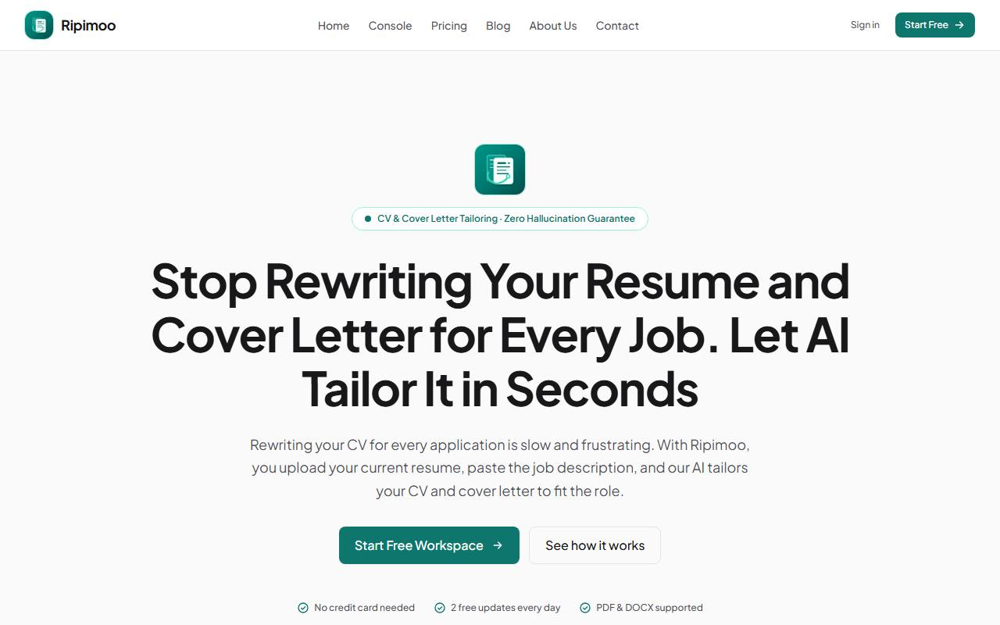
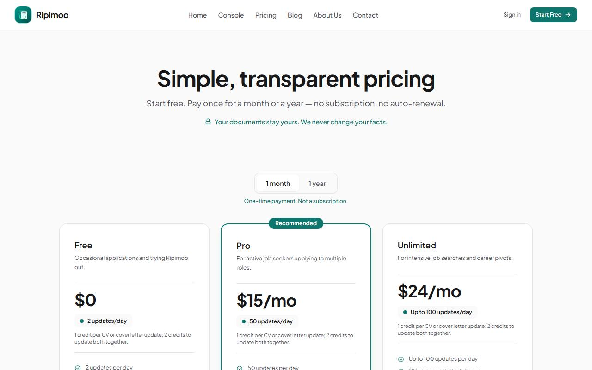
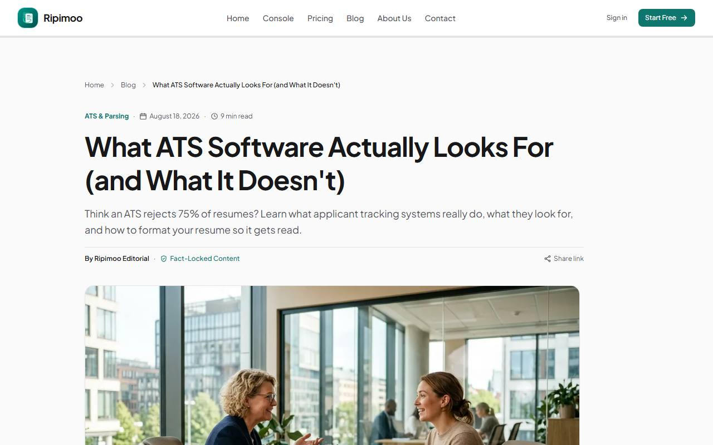

# Ripimoo

**Live site: [https://ripimoo.com](https://ripimoo.com)**

Ripimoo tailors your CV and cover letter to match a specific job description — without inventing anything you didn't already write.

- **Locked facts.** Job titles, employers, dates, and education are detected and locked before any rewriting happens. The AI can only rephrase wording around them, never add experience, skills, or credentials you don't have.
- **You approve every change.** Each suggested rewording shows up as a before/after card with a reason. You accept, skip, or edit it — nothing is applied silently.
- **Honest about gaps.** If the job description asks for something your CV doesn't support, Ripimoo says so in a "Not found in your CV" list instead of making it up.

## What's in this repo

This is a **front-end showcase** of the public-facing site — the pages anyone can visit without signing in: home, pricing, blog, about, contact, legal pages, and the sign-in screen's UI.

**The backend, AI pipeline, document parsing/export, payment integration, and security/auth code are private** and are not included here. A few public pages that normally call into that private code (the session check in the header, the sign-in button, the contact form, the pricing page's checkout button) have had those calls replaced with harmless stubs so the UI still renders — they don't actually sign you in, submit a form, or charge a card in this repo.

Because of that, **this repo is not expected to build or run standalone** — it's here to show the front-end code, not to be deployed.

## Tech stack

| Layer | Choice |
|---|---|
| Frontend | Next.js (App Router), Tailwind CSS |
| Hosting | Cloudflare Workers |
| Database / Auth | Supabase (Postgres, RLS, Google OAuth) — *private* |
| AI | Anthropic Claude — *private* |
| Payments | Paddle — *private* |

## Screenshots

| Home | Pricing | Blog post |
|---|---|---|
|  |  |  |

## License

Copyright (c) 2026 Ripimoo. All rights reserved. See [LICENSE](LICENSE).
